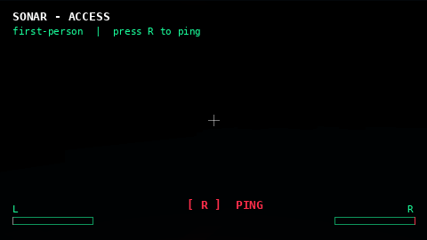
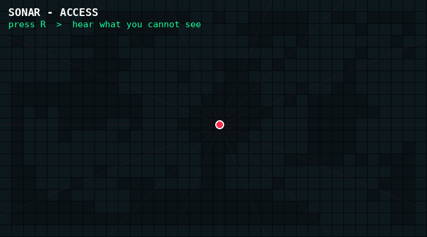

<div align="center">



**A Fabric mod that turns Minecraft into 3D sound, so blind and low-vision players can explore by ear.**

By **BagelEater**


[Features](#-features) | [See it](#-see-it-in-action) | [Controls](#-controls) | [How it works](#-how-it-works) | [Install](#-installation) | [FAQ](#-faq)

</div>

---

## 🔊 What is SONAR?

**SONAR gives you a new way to see: with your ears.**

It uses **spatial audio** to place every wall, drop, pool of water and open doorway in 3D space around your head. Press a key and the world answers back with sound, each one coming from exactly where the thing is. Left sounds on your left. Behind sounds behind you. Near sounds loud, far sounds soft.

With a pair of headphones you can tell:

- 🧱 **where the walls are**, and how far away
- ⚠️ **where the edge is**, before you walk off it
- 🌊 **where the water and lava are**, so you never wander into them
- 🛤️ **where the path goes**, so you can follow roads and corridors
- 🏛️ **how big the room is**, from the echo alone
- 🧍 **where your friends are**, from their jingle

No mods on the server. No special hardware. No sighted help. Just install it, put on headphones and press **R**.

---

## ✨ Features

| | |
|---|---|
| 🎧 **True 3D sound** | Every sound comes from its real direction, with sounds behind you quieter, lower and muffled, just like real life. |
| 📡 **Instant sonar scan** | One key press scans a bubble of up to 60 blocks around you. |
| 🔄 **Auto-scan** | Hold **R** and SONAR pings on its own, hands free. |
| ⚠️ **Ledge warning** | A blip that speeds up as you near drops, steep slopes and lava. |
| 🛑 **Edge brake** | Optionally slows you before a real drop, never traps you. |
| 🌊 **Cave and room echoes** | Hear the size of the space you are standing in. |
| 🛤️ **Path guide** | A bell that leads you along built paths. |
| 🗣️ **Spoken help** | Identify what you are looking at, or hear a summary of the room. |
| 🧍 **Player chime** | Find other players by their jingle. |
| 🎛️ **Fully adjustable** | Volumes, range, keys and every cue can be changed in game. |

---

## 🎬 See it in action

> Both clips are stylised visualisations of how SONAR works, not recordings of the game.

<div align="center">

### First person: the pulse goes out, the walls light up



### From above: SONAR only reports what you could actually see



</div>

---

## 🎮 Controls

| Key | Action | What happens |
|:---:|---|---|
| **R** | Scan | Tap for one scan of everything around you. **Hold for 2 seconds** to switch auto-scan on or off. |
| **V** | Front scan | Listen only to what is in front of you. |
| **B** | Spoken summary | Does a scan, then reads out a summary of what is around you. |
| **N** | Identify | Tells you the name and distance of whatever your crosshair is pointing at, block or creature. |
| **H** | Echo | Turns the room echo on or off. |
| **J** | Ledge warning | Turns the drop warning on or off. |

Every key can be changed. Open the pause menu, choose **Sonar Settings**, then **Keys**, click a button and press the key you want.

---

## 🧠 How it works

Think of SONAR as a friendly bat that lives in your ears. Every time you scan, it goes through three simple steps.

### 1. 👀 It looks around you

SONAR checks the blocks in a big bubble around you. It cuts the bubble into 16 slices like a pizza, each split into 3 heights: low, middle and high. Then it sorts everything it finds into four kinds: **dangers**, **solid things** like walls and floors, **things you can touch**, and **water**.

Each slice only gets to speak for the most important thing in it, so you hear a clear picture instead of a wall of noise. And it plays fair: a block only counts if you could really see it. Something hidden behind a wall stays quiet.

It does this scanning in tiny pieces, a few layers at a time, so your game never freezes or stutters.

### 2. 🎧 It turns what it found into sound

Every winner becomes a sound that comes from the real direction of the thing. Something on your left sounds on your left. Something behind you sounds quieter, lower and a little muffled, just like in real life.

When sounds compete, the most important one goes first:

1. **Danger** first
2. **Walls** second
3. **Things you can touch** last

The sounds are also spaced a tiny moment apart, closest and front-most first, so they come across like a clear sentence rather than everyone shouting at once. Far-away things are brought a little closer in your ears, so you can still hear them clearly within Minecraft's sound limits.

### 3. 🌊 It listens for echoes

Inside a cave or a closed room, SONAR adds an echo, the way you can *feel* the size of a bathroom or a cathedral with your eyes shut. A small room gives a short, high echo. A big hall gives a long, low one. Far echoes come first and the nearest comes last, so you can tell how big the space is and where the walls are.

---

## 🛰️ Always-on helpers

These keep working while you walk, without you pressing anything.

**⚠️ Ledge warning.** Walk toward a drop, a steep slope or lava and you hear a blip that gets faster as you get closer. Ordinary stairs and fenced edges are ignored, so it only warns you when it matters. It quiets down when you stand still and stays silent while you sneak.

**🛑 Edge brake (optional).** If you run at a real drop, SONAR can slow you down for half a second so you have time to react. It never traps you: sneaking, stopping or turning away cancels it instantly.

**🛤️ Path guide.** On a built path, a bell rings from 8 to 11 blocks ahead so you can follow roads and corridors. It stays out of your way inside buildings and on wide open plazas.

**🟫 Floor edges.** Tells you where a built floor begins or ends, like stepping from grass onto a stone road.

**🌊 Water and lava loop.** When you are within a few blocks of water or lava, it keeps sounding every couple of seconds so you always know it is there.

**💥 Stuck thud.** Walk into a wall and you get a thud about once a second. Two thuds in a row means the wall is two or more blocks tall, so you cannot jump it.

**🧍 Player chime.** Other players give off a constant jingle, so you can find your friends.

**🗣️ Speech.** SONAR speaks its messages with a Windows voice and falls back to Minecraft's own narrator if that is not available.

**🔄 Auto-scan.** Hold **R** and SONAR pings on its own at a steady rhythm, with an echo a moment after each ping.

---

## 🎛️ Make it yours

Open the pause menu and choose **Sonar Settings**. Everything is there, with sub-screens for **Volumes**, **Keys** and **More**.

| Setting | What it does |
|---|---|
| Sonar range | How far you can hear, from 15 to 60 blocks |
| Direction spread | Exaggerates left and right so directions are easier to tell apart |
| Smallest drop warned | The smallest fall, from 2 to 8 blocks, that triggers a warning |
| Switches | Hazard cue, close-range touch, gap and door cues, stuck cue, water and lava, path guide, floor edges, edge brake, and sonar off inside |
| Reset | One button puts everything back to the defaults |

Settings are saved in `config/sonar.json` and reload instantly, so you can edit the file while the game is running. If the file ever has a mistake, SONAR keeps your last good settings instead of breaking. The first time you play, SONAR also switches on Minecraft's *Directional Audio* setting so you get proper 3D sound.

---

## 📋 Requirements

| | |
|---|---|
| Minecraft | 26.3 |
| Fabric Loader | 0.19.5 or newer |
| Fabric API | Required |
| Java | 25 or newer |
| Environment | Client only |

**Tip:** use stereo headphones. The 3D sound is what makes SONAR work.

## 📥 Installation

1. Install [Fabric Loader](https://fabricmc.net/use/) for Minecraft 26.3.
2. Download [Fabric API](https://modrinth.com/mod/fabric-api) and the SONAR `.jar`.
3. Put both files in your `mods` folder.
4. Start the game and press **R**.

## 🛠️ Building from source

```bash
git clone https://github.com/bageleater98/SONAR-access-for-the-blind.git
cd SONAR-access-for-the-blind
./gradlew build
```

The finished jar appears in `build/libs/`. You need JDK 25 or newer.

## 🗂️ Project layout

```
src/client/java/com/sonar/    The mod: Scan, Cues, helpers, and the settings screens
src/main/resources/           fabric.mod.json and assets
  assets/sonar/sounds/m/      Muffled copies of vanilla block sounds
DESIGN.md                     Technical design notes
```

For the full technical details, see [DESIGN.md](DESIGN.md).

## 🙇 Getting help and feedback

SONAR is built for blind players, so your feedback shapes it more than anything else. If a sound is confusing, too loud or missing, please [open an issue](../../issues).

## ❓ FAQ

**Do I need to install anything on the server?**
No. SONAR runs only on your own computer, so it works in singleplayer and on any server that allows client mods.

**Do I need headphones?**
Strongly recommended. The 3D sound is what tells you the direction of things, and stereo headphones are what make that work.

**Will it slow my game down?**
It is built not to. The scan is spread out in small pieces over many game ticks, so the game does not freeze or stutter.

**Can I change the keys?**
Yes. Open the pause menu, choose **Sonar Settings**, then **Keys**.

**It is too loud, too busy or too quiet. What can I do?**
Open **Sonar Settings**. You can change volumes and range, and switch off any cue you do not want.

**Can I report a problem or suggest an idea?**
Please do. See the section below.

---

## 👏 Credits

Created by **BagelEater**. Built with [Fabric](https://fabricmc.net/).

## 📜 License

Released under [CC0-1.0](LICENSE), public domain. Use it, learn from it, and build on it.
